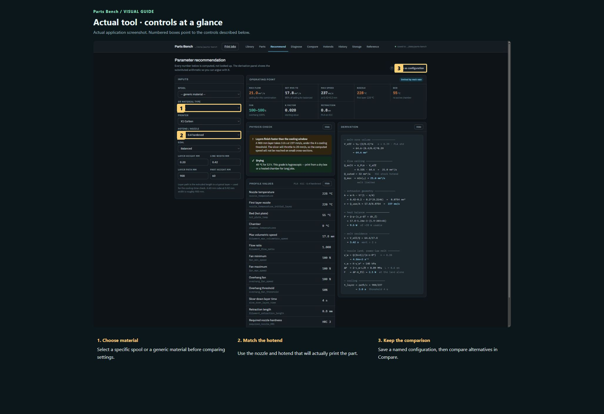
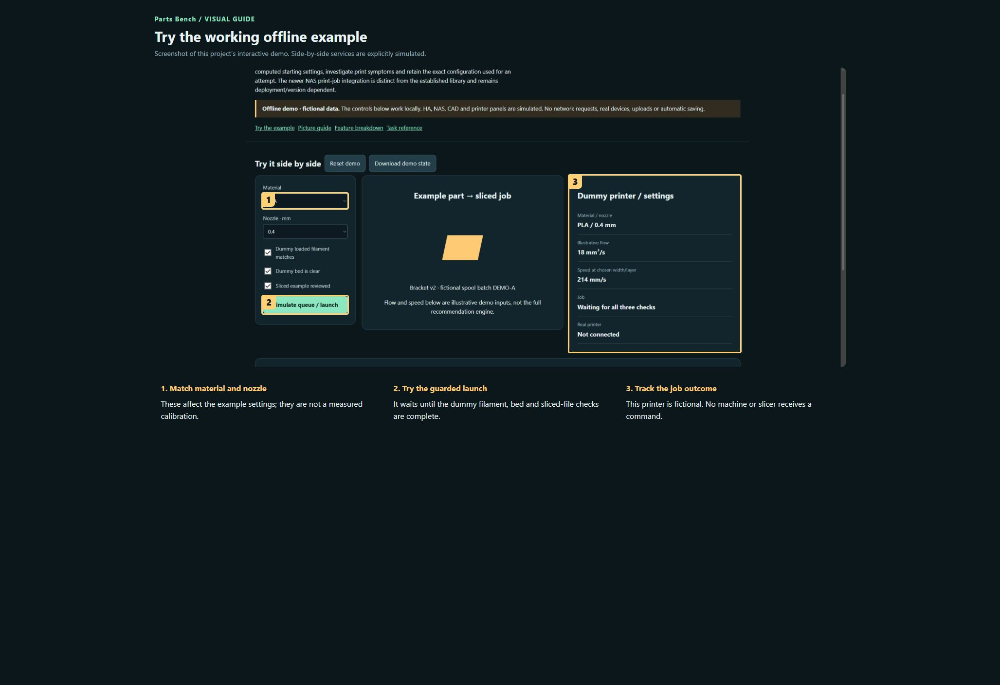

# Parts Bench

**Maintaining this project? [Start here](docs/START-HERE.md) · [Detailed handover](docs/HANDOVER.md)**

Keep a traceable library of printed parts, versions, spools, batches, hotends and print records. Compare computed starting settings, investigate print symptoms and retain the exact configuration used for an attempt. The newer NAS print-job integration is distinct from the established library and remains deployment/version dependent.

**Private preview · not published.**

[Open the visual manual](docs/USER-MANUAL.md) · [Download the self-contained demo](demo.html) · [Release notes](CHANGELOG.md)

Download `demo.html` using GitHub’s Download raw file control, then open it in your browser. GitHub displays HTML source; it does not run the demo on this page. The demo is an offline simulation with fictional data and makes no network requests.

## See it

### Actual tool · controls at a glance

Actual application screenshot. Numbered boxes point to the controls described below.

1. **Choose material.** Select a specific spool or a generic material before comparing settings.
2. **Match the hotend.** Use the nozzle and hotend that will actually print the part.
3. **Keep the comparison.** Save a named configuration, then compare alternatives in Compare.

### Try the working offline example

Screenshot of this project’s interactive demo. Side-by-side services are explicitly simulated.

1. **Match material and nozzle.** These affect the example settings; they are not a measured calibration.
2. **Try the guarded launch.** It waits until the dummy filament, bed and sliced-file checks are complete.
3. **Track the job outcome.** This printer is fictional. No machine or slicer receives a command.

## What this tool does

| Feature | What it lets you do | Where |
| --- | --- | --- |
| Spool library | Track brand, type, colour, batch, condition, quality and measured flow. | Library and workflow |
| Part versions | Store model files and extracted 3MF/STL metadata without losing version identity. | Library and workflow |
| Recommendations | Show calculated settings and substituted arithmetic based on material, hotend and goals. | Library and workflow |
| Compare | Save configurations side by side and highlight differing values. | Library and workflow |
| Diagnose | Rank possible causes for selected symptoms under the stated maintenance assumptions. | Library and workflow |
| Print history | Link part version, exact spool/batch and hotend to a frozen settings snapshot. | Library and workflow |
| Storage and audit | Review file inventory, imports, fingerprints and field-level change history. | Library and workflow |
| NAS print jobs | Where configured, separate immutable sliced jobs from physical launch attempts and filament selection. | Library and workflow |

## A first useful workflow

### Create traceable material and part records

1. Start in Library. Add a spool or import a supported filament profile; record the batch instead of treating all spools of a product as interchangeable.
2. In Parts, upload the intended STL or 3MF and review extracted metadata and preview. Keep a new revision as a version, not an unrelated overwrite.
3. Review printer/nozzle and part bounds when present. A model-only file is not a ready-to-launch sliced job.

## Saving and outputs

The library owns its model-folder layout, metadata and database. Back up the complete root including _bench, not only the visible STL files. Browser drafts and saved shared records are different. Print-job snapshots/attempt history need their own preserved storage.

## Running the actual tool

Read projects-host/parts-bench/src/partsbench/README.md for the base library; hosted printer actions require the NAS integration.

The demo has no prerequisites; the real tool may need the services described in the manual and retained source notes.

## Current boundaries

Source was split from a private checkpoint while print-job integration was still evolving. Read the retained implementation notes before deploying. This is not a clean-machine or physical-print validation of the newer integration.

## Licence and sharing

MIT applies to original project contributions. Bundled/upstream software and assets retain their own terms; see [third-party notes](THIRD-PARTY.md). Keep this repository private until its own [release checklist](RELEASE-CHECKLIST.md) is complete and the owner authorises publication.
